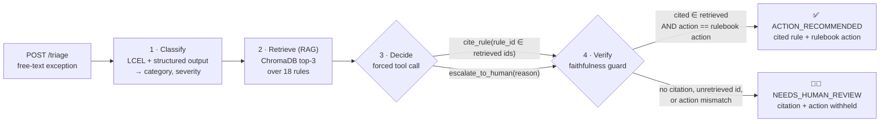

# RegOps Triage Agent

**A guarded, auditable LLM workflow for regulatory-operations triage. It classifies a free-text compliance or
data-quality exception, retrieves the governing rule with RAG, picks an action through a constrained tool call, and
verifies that the action is grounded in a retrieved rule. If it can't cite a rule, it flags the case for human review.**


---

## Contents

[Problem](#the-problem) · [Architecture](#architecture) · [Example](#example) · [Features](#key-features) ·
[Tech stack](#tech-stack) · [Quick start](#quick-start) · [API](#api) · [Testing](#testing--build-gates) ·
[Evaluation](#evaluation) · [Deployment](#deployment) · [Tradeoffs](#tradeoffs--engineering-decisions) ·
[Limitations & roadmap](#limitations--roadmap)

## The problem

Regulatory-operations teams work through a steady stream of free-text exceptions: a power bank listed without a
UN38.3 test summary, a supplement claiming to cure diabetes, an aerosol with no UN number. Each one has to be matched
to the rule that governs it before anyone acts. An LLM can speed this up, but in a compliance setting it's only
useful if it can show **which rule** justifies each action, and if it **declines to act** when it can't.

This project treats that as a workflow-engineering problem:

- **Structured at every boundary.** Inputs and outputs are typed Pydantic models, and the LLM can only answer through
  structured output or a constrained tool schema.
- **Grounded, not generated.** The recommended action is copied word for word from the rulebook entry of a
  *retrieved* rule. The LLM never writes it.
- **Verified independently.** A separate verify stage checks each decision against the retrieved set and the
  rulebook. Anything it can't confirm goes to `NEEDS_HUMAN_REVIEW`.

## Architecture



| Stage | Module | What it does |
| --- | --- | --- |
| Classify | [`app/stages/classify.py`](app/stages/classify.py) | LCEL chain `prompt \| llm.with_structured_output(Classification)` → one of 12 categories or `NO_MATCH`, plus severity |
| Retrieve | [`app/rag.py`](app/rag.py) | Embeds the raw exception text and queries a persistent Chroma collection (cosine, top-3) |
| Decide | [`app/stages/decide.py`](app/stages/decide.py) | Binds two tools with forced tool choice: `cite_rule(rule_id: enum[retrieved ids], rationale)` and `escalate_to_human(reason)` |
| Verify | [`app/stages/verify.py`](app/stages/verify.py) | Re-checks the citation and action from scratch, then sets `faithful` and `status` |
| Orchestrate | [`app/pipeline.py`](app/pipeline.py) | Runs the four stages, logs per-stage timings, and blanks the citation and action whenever `faithful=false` |

## Example

The two responses below come from a running server (`LLM_PROVIDER=offline`). Rule texts are shortened with `…`.

**A governed exception → action recommended**

```bash
curl -s -X POST http://127.0.0.1:8000/triage -H "Content-Type: application/json" \
     -d '{"text": "Vendor submitted a power bank listing but attached no battery safety test documentation."}'
```

```json
{
  "input_text": "Vendor submitted a power bank listing but attached no battery safety test documentation.",
  "category": "DOCUMENTATION_MISSING",
  "severity": "MEDIUM",
  "retrieved_rules": [
    {"rule_id": "R-001", "text": "Lithium-ion batteries or products containing them (power banks, cordless devices) …", "score": 0.3866},
    {"rule_id": "R-002", "text": "Cosmetic and personal-care products offered without a product safety data sheet …", "score": 0.2398},
    {"rule_id": "R-007", "text": "Products listed under an incorrect product-type or HS/commodity code …", "score": 0.0847}
  ],
  "cited_rule_id": "R-001",
  "recommended_action": "Request UN38.3 test summary from vendor; hold listing until received.",
  "status": "ACTION_RECOMMENDED",
  "faithful": true,
  "rationale": "Rule R-001 matches the exception's category (DOCUMENTATION_MISSING) with lexical similarity 0.34 (offline deterministic model). | verify: Cited rule R-001 is in the retrieved set and the action matches the rulebook."
}
```

**Not a compliance exception → escalated to a human**

```json
{
  "input_text": "Vendor emailed asking what time the warehouse closes for drop-off on Fridays.",
  "category": "NO_MATCH",
  "severity": "LOW",
  "retrieved_rules": [
    {"rule_id": "R-004", "text": "Weapons, weapon replicas, and realistic imitation firearms …", "score": 0.1086},
    {"rule_id": "R-010", "text": "Health, medical or disease-treatment claims on non-medical products …", "score": 0.0765},
    {"rule_id": "R-005", "text": "Food, supplements and ingestible products must carry allergen labeling …", "score": 0.0539}
  ],
  "cited_rule_id": null,
  "recommended_action": null,
  "status": "NEEDS_HUMAN_REVIEW",
  "faithful": false,
  "rationale": "No retrieved rule both matches the classified category (NO_MATCH) and is lexically similar enough to the exception (offline deterministic model). | verify: No retrieved rule was cited; refusing to act without a citable rule."
}
```

## Key features

- **Faithfulness guard enforced in three places.** The tool schema only allows retrieved ids. Decide then throws away
  any id outside that set. Verify re-derives `faithful` from scratch. [Details ↓](#the-faithfulness-guard)
- **Human-in-the-loop by design.** The decide model can call `escalate_to_human` itself. Verify also routes to
  `NEEDS_HUMAN_REVIEW` on a missing citation, an unretrieved id, or an action that doesn't match the rulebook.
  Escalated results return `cited_rule_id=null` and `recommended_action=null`. The rejected citation id (if any) and
  the reason are recorded in `rationale` for audit. This is a status flag; there's no review queue yet
  ([roadmap](#limitations--roadmap)).
- **Prompt-injection hardening.** User text is escaped (`<`/`>`) before it enters a prompt, so an exception can't forge
  a `<rule>` tag. The system prompt marks the exception text as untrusted data. So far this has only been tested
  against the offline provider.
- **Provider-agnostic.** `get_llm()` and `get_embeddings()` in [`app/llm.py`](app/llm.py) choose the provider from
  `LLM_PROVIDER` (`gemini` · `openai` · `anthropic` · `ollama` · `offline`). No stage imports a provider SDK.
- **Deterministic offline mode.** `LLM_PROVIDER=offline` implements the same LangChain interfaces, so tests, gates and
  the eval can run with no API key and no network calls to an LLM.
- **Self-invalidating vector index.** Chroma collections are keyed by *embedding model + rules-file fingerprint*.
  Edit the rulebook (picked up on restart) or switch embedding models and you get a fresh index, so deleted rules
  can't come back.
- **Typed contracts and clear errors.** Request bodies must be 1–4000 characters with at least one non-whitespace
  character (otherwise `422`). An unknown provider, a missing API key, or a missing provider package returns `503`.
  An upstream LLM or embedding failure, including an invalid or placeholder key, returns `502`. The API never
  fabricates a result.

## Tech stack

| Layer | Technology |
| --- | --- |
| Orchestration | **LangChain** 1.4 / `langchain-core` 1.6: LCEL chains, `with_structured_output`, `bind_tools` with forced `tool_choice` |
| LLM (default) | **Google Gemini** `gemini-2.5-flash` via `langchain-google-genai` (switchable to OpenAI, Anthropic, Ollama) |
| Embeddings | Gemini `models/gemini-embedding-001` (offline: hashed word-stem + char-4-gram, 1024-d) |
| Vector store | **ChromaDB** 1.5, local persistent client, cosine HNSW |
| Contracts & validation | **Pydantic** v2 (`ExceptionIn`, `TriageResult`, `RuleHit`, `Severity`, `Status`) |
| API & UI | **FastAPI** + Uvicorn; **Gradio** demo UI mounted at `/` |
| Testing | **pytest** (54 tests), build-spec gates (`scripts/gates.py`), eval harness (`app/eval.py`) |
| Packaging | Docker (`python:3.13-slim`, non-root user, listens on `$PORT`) |

## Quick start

Requires Python 3.13 (the version used to build and test this repo, and the Dockerfile base image).

```bash
python -m venv .venv
source .venv/Scripts/activate      # Windows Git Bash  (PowerShell: .venv\Scripts\Activate.ps1; Linux/macOS: source .venv/bin/activate)
pip install -r requirements.txt
cp .env.example .env               # then set GOOGLE_API_KEY, or set LLM_PROVIDER=offline to run without a key

uvicorn app.main:app --reload      # UI: http://127.0.0.1:8000/   OpenAPI docs: http://127.0.0.1:8000/docs
```

> **Note:** `.env.example` defaults to `LLM_PROVIDER=gemini` with a placeholder key. Put in a real
> `GOOGLE_API_KEY`, or switch to `LLM_PROVIDER=offline` for a key-less demo.

<details>
<summary><b>Configuration reference</b></summary>

| Variable | Default | Purpose |
| --- | --- | --- |
| `LLM_PROVIDER` | `gemini` | `gemini` · `openai` · `anthropic` · `ollama` · `offline` |
| `EMBEDDINGS_PROVIDER` | same as `LLM_PROVIDER` | Override the embeddings backend (`gemini` · `openai` · `ollama` · `offline`). If unset and `LLM_PROVIDER=anthropic`, embeddings fall back to `offline`, since Anthropic has no embeddings API |
| `GOOGLE_API_KEY` | — | Required for `gemini` |
| `GEMINI_MODEL` / `GEMINI_EMBEDDING_MODEL` | `gemini-2.5-flash` / `models/gemini-embedding-001` | Gemini model overrides |
| `OPENAI_API_KEY`, `OPENAI_MODEL`, `OPENAI_EMBEDDING_MODEL` | — / `gpt-4o-mini` / `text-embedding-3-small` | Needs `pip install langchain-openai` |
| `ANTHROPIC_API_KEY`, `ANTHROPIC_MODEL` | — / `claude-haiku-5-5` | Needs `pip install langchain-anthropic` |
| `OLLAMA_MODEL`, `OLLAMA_EMBEDDING_MODEL` | `llama3.1` / `nomic-embed-text` | Needs `pip install langchain-ollama` |
| `CHROMA_DIR` | `.chroma` (`/tmp/chroma` in Docker) | Persistent index directory. A fresh index is built automatically when the embedding model changes, or on startup when the rules change |
| `PORT` | `8080` (Docker) | Container listen port |

</details>

## API

| Method | Path | Description |
| --- | --- | --- |
| `POST` | `/triage` | Body `{"text": "..."}` → `TriageResult` |
| `GET` | `/healthz` | `{"status": "ok", "llm_provider": "<provider>"}` |
| `GET` | `/docs` | Interactive OpenAPI docs (FastAPI) |
| `GET` | `/` | Gradio demo UI with example inputs |

`TriageResult` fields: `input_text`, `category`, `severity` (`LOW`/`MEDIUM`/`HIGH`), `retrieved_rules[]`
(`rule_id`, `text`, `score`), `cited_rule_id`, `recommended_action`, `status`, `faithful`, `rationale`.

**Status semantics:** `ACTION_RECOMMENDED` means a retrieved rule is cited and its rulebook action is returned.
`NEEDS_HUMAN_REVIEW` means anything else. In that case `faithful=false`, including a correct refusal on a
non-exception. `RESOLVED` exists in the contract but nothing emits it yet; it's reserved for a future auto-close path.

## Testing & build gates

```bash
pytest                                             # 54 tests; conftest forces offline + a temp Chroma dir
LLM_PROVIDER=offline python -m app.eval            # eval harness; exits 1 if any target is missed
LLM_PROVIDER=offline python scripts/gates.py all   # build-spec gates 0–8 (or one gate: scripts/gates.py 5)
```

Only `pytest` forces the offline provider. The eval and the gates use whatever `LLM_PROVIDER` is set in the
environment or `.env`, so prefix them with `LLM_PROVIDER=offline` to run without a key and reproduce the numbers
below.

The tests cover the API contract (`422` on bad bodies), injected or unretrieved citations, tampered actions, a
rogue model that smuggles citations through decide, `<rule>`-tag injection, no-match routing, index rebuild and
reuse, a single shared rulebook snapshot, and repo hygiene.

A gate prints `GATE N PASS` only when every check it can run succeeds. Checks that can't run on the current machine
print `DEFERRED` and are never silently passed.

| Gate | Checks | Result on build machine |
| --- | --- | --- |
| 0 | uvicorn serves, `POST /triage` schema-valid, UI at `/`, 422 on bad input, `docker build` | PASS · docker build **deferred** (Docker not installed) |
| 1 | schemas import, `get_llm().invoke("ping")`, embeddings, structured output, Gemini wiring | PASS on `offline` · live Gemini ping **deferred** (no key) |
| 2 | expected rule in top-3, recall@3 ≥ 0.9, persistent index reload | PASS (recall@3 = 1.00 over 22 labeled cases) |
| 3 | 3 novel inputs classify into valid enums | PASS |
| 4 | citation is always a retrieved id or null (eval set, rogue model, unretrieved real id) | PASS |
| 5 | injected fake or unretrieved citation, tampered action, no citation, rogue LLM → `faithful=False`, `NEEDS_HUMAN_REVIEW` (plus an honest control) | PASS |
| 6 | end-to-end HTTP on 3 inputs: faithful, schema-valid | PASS |
| 7 | accuracy ≥ 0.7, faithfulness = 1.0, no-match → human review, adversarial eval | PASS (0.960 / 1.000) |
| 8 | `pytest` green, docker build (or a clean-venv smoke test on the host when Docker is missing), public URL | PASS (54 tests, host smoke OK) · docker build and public URL **deferred** |

## Evaluation

`python -m app.eval` runs the 25 labeled cases in [`data/eval_set.jsonl`](data/eval_set.jsonl) through the full
pipeline: 22 governed exceptions and 3 `NO_MATCH` non-exceptions.

> [!IMPORTANT]
> **These numbers come from the deterministic `offline` provider, not a real LLM.** The offline stand-in answers by
> lexical similarity against the classify prompt's taxonomy descriptions, which were written with the rulebook in view. So these results measure
> the **pipeline wiring and the guard**, not LLM reasoning quality. **No Gemini (or other real-LLM) eval has been
> recorded yet**, because the build machine has no API key. Treat real-model performance as unmeasured.

| Metric | Offline result | Target | What it shows |
| --- | --- | --- | --- |
| Classification accuracy | **0.960** (24/25) | ≥ 0.7 | Predicted category == expected category |
| faithfulness rate | **1.000** | = 1.0 | No hallucinated citations, re-checked from scratch instead of trusting the result's own flag |
| Cited-rule accuracy | 0.960 | — | Diagnostic |
| No-match → human review | 1.000 | = 1.0 | Non-exceptions are never acted on |
| Retrieval recall@3 | 1.000 | — | Expected rule appears in the top 3 |
| **Adversarial:** model always invents `R-999` | faithfulness **1.000**, **25/25** invented citations caught | — | Shows the guard actually catches citations a model makes up (Gate 7) |

The guard enforces faithfulness by construction, so the 1.000 rate works as a regression alarm. The adversarial run
is what shows the guard catching hallucinated citations.

**Known miss, E-24:** this case has two issues, a corrosive with no ADR class *and* a copied trademark. The offline
model picks the IP issue over the more safety-critical HAZMAT one. It still cites a *real, retrieved* rule, so
faithfulness holds.

<details>
<summary><b>Full eval output</b> (<code>LLM_PROVIDER=offline</code>, 2026-10-22)</summary>

```
RegOps Triage eval  provider=offline  embeddings=offline/hash-1024  n=25

id    expected_category       predicted               cat exp_rule cited    rule status              faithful
-------------------------------------------------------------------------------------------------------------
E-01  DOCUMENTATION_MISSING   DOCUMENTATION_MISSING   ok  R-001    R-001    ok   ACTION_RECOMMENDED  True
E-02  DOCUMENTATION_MISSING   DOCUMENTATION_MISSING   ok  R-002    R-002    ok   ACTION_RECOMMENDED  True
E-03  RESTRICTED_PRODUCT      RESTRICTED_PRODUCT      ok  R-003    R-003    ok   ACTION_RECOMMENDED  True
E-04  RESTRICTED_PRODUCT      RESTRICTED_PRODUCT      ok  R-004    R-004    ok   ACTION_RECOMMENDED  True
E-05  LABELING_NONCOMPLIANCE  LABELING_NONCOMPLIANCE  ok  R-005    R-005    ok   ACTION_RECOMMENDED  True
E-06  LABELING_NONCOMPLIANCE  LABELING_NONCOMPLIANCE  ok  R-006    R-006    ok   ACTION_RECOMMENDED  True
E-07  MISCLASSIFICATION       MISCLASSIFICATION       ok  R-007    R-007    ok   ACTION_RECOMMENDED  True
E-08  MISCLASSIFICATION       MISCLASSIFICATION       ok  R-008    R-008    ok   ACTION_RECOMMENDED  True
E-09  AGE_RESTRICTION         AGE_RESTRICTION         ok  R-009    R-009    ok   ACTION_RECOMMENDED  True
E-10  PROHIBITED_CLAIM        PROHIBITED_CLAIM        ok  R-010    R-010    ok   ACTION_RECOMMENDED  True
E-11  PROHIBITED_CLAIM        PROHIBITED_CLAIM        ok  R-011    R-011    ok   ACTION_RECOMMENDED  True
E-12  DATA_QUALITY            DATA_QUALITY            ok  R-012    R-012    ok   ACTION_RECOMMENDED  True
E-13  DATA_QUALITY            DATA_QUALITY            ok  R-013    R-013    ok   ACTION_RECOMMENDED  True
E-14  COUNTRY_OF_ORIGIN       COUNTRY_OF_ORIGIN       ok  R-014    R-014    ok   ACTION_RECOMMENDED  True
E-15  HAZMAT                  HAZMAT                  ok  R-015    R-015    ok   ACTION_RECOMMENDED  True
E-16  IP_INFRINGEMENT         IP_INFRINGEMENT         ok  R-016    R-016    ok   ACTION_RECOMMENDED  True
E-17  OFFENSIVE_CONTENT       OFFENSIVE_CONTENT       ok  R-017    R-017    ok   ACTION_RECOMMENDED  True
E-18  ENERGY_LABELING         ENERGY_LABELING         ok  R-018    R-018    ok   ACTION_RECOMMENDED  True
E-19  DOCUMENTATION_MISSING   DOCUMENTATION_MISSING   ok  R-001    R-001    ok   ACTION_RECOMMENDED  True
E-20  PROHIBITED_CLAIM        PROHIBITED_CLAIM        ok  R-010    R-010    ok   ACTION_RECOMMENDED  True
E-21  COUNTRY_OF_ORIGIN       COUNTRY_OF_ORIGIN       ok  R-014    R-014    ok   ACTION_RECOMMENDED  True
E-22  NO_MATCH                NO_MATCH                ok  -        -        ok   NEEDS_HUMAN_REVIEW  False
E-23  NO_MATCH                NO_MATCH                ok  -        -        ok   NEEDS_HUMAN_REVIEW  False
E-24  HAZMAT                  IP_INFRINGEMENT         XX  R-015    R-016    XX   ACTION_RECOMMENDED  True
E-25  NO_MATCH                NO_MATCH                ok  -        -        ok   NEEDS_HUMAN_REVIEW  False

classification accuracy : 0.960
faithfulness rate       : 1.000   (no hallucinated citations; must be 1.000)
cited-rule accuracy     : 0.960
no-match -> human review: 1.000
retrieval recall@3      : 1.000
invented citations caught by guard: 0

EVAL PASS (accuracy >= 0.7, faithfulness == 1.0, no-match -> human review == 1.0)
```

</details>

**To record a real-LLM run** (needs a key):

```bash
LLM_PROVIDER=gemini python -m app.eval --out eval_gemini.json   # also: --min-accuracy 0.7, --eval-set <path>
```

## Deployment

> **Status:** a Dockerfile is provided, but the image has **not been built or deployed**. No public URL exists,
> Gate 8's URL check is deferred, and neither the Cloud Run nor the App Runner commands below have been run from this
> repo. Docker isn't installed on the build machine, so Gate 8 instead runs a clean-venv smoke test on the host that
> mimics the Dockerfile's install and copy steps. That is not a real container run.

The container is configured to listen on `$PORT` (default 8080), builds the Chroma index into `/tmp/chroma` at startup, and runs as
a non-root user.

```bash
docker build -t regops-triage-agent .
docker run --rm -p 8080:8080 -e LLM_PROVIDER=gemini -e GOOGLE_API_KEY=$GOOGLE_API_KEY regops-triage-agent
```

### GCP Cloud Run (primary target)

```bash
gcloud run deploy regops-triage-agent \
  --source . --region europe-central2 \
  --allow-unauthenticated \
  --max-instances 1 --session-affinity \
  --set-env-vars LLM_PROVIDER=gemini,GOOGLE_API_KEY=$GOOGLE_API_KEY
```

- `--max-instances 1 --session-affinity` keeps the Gradio UI working, because its queue lives in process memory.
  `POST /triage` is stateless and scales freely if you drop the UI.
- Consider `--memory 1Gi` (not profiled; Gradio and Chroma may exceed the 512 MiB default). Beyond a demo,
  keep the key in Secret Manager (`--set-secrets GOOGLE_API_KEY=google-api-key:latest`). To demo without a key,
  deploy with `LLM_PROVIDER=offline`.
- Verify a deployment: `PUBLIC_URL=https://<service-url> python scripts/gates.py 8`

<details>
<summary><b>AWS alternative: App Runner (same Dockerfile, untested recipe)</b></summary>

```bash
aws ecr create-repository --repository-name regops-triage-agent
aws ecr get-login-password | docker login --username AWS --password-stdin <acct>.dkr.ecr.<region>.amazonaws.com
# App Runner runs linux/amd64 only: --platform is required when building on Apple Silicon / ARM
docker build --platform linux/amd64 -t <acct>.dkr.ecr.<region>.amazonaws.com/regops-triage-agent:latest .
docker push <acct>.dkr.ecr.<region>.amazonaws.com/regops-triage-agent:latest
# App Runner console/CLI: source = that ECR image, port 8080,
# env LLM_PROVIDER=gemini and GOOGLE_API_KEY (prefer a Secrets Manager reference), health check path /healthz.
# App Runner has no sticky sessions, so pin one instance for the Gradio UI:
aws apprunner create-auto-scaling-configuration --auto-scaling-configuration-name regops-single \
  --min-size 1 --max-size 1     # pass the returned ARN as --auto-scaling-configuration-arn on create-service
```

The provider is a runtime env var, not a code change, so the same image should run on Cloud Run, App Runner, or any
container host.

</details>

## Tradeoffs & engineering decisions

| Decision | Choice | Why |
| --- | --- | --- |
| Agent style | LCEL chains with an explicit retrieve step. Explicit tool selection happens **only** in decide. Classify uses `with_structured_output`, which some providers (including offline) implement as a single forced tool call | A fixed, inspectable pipeline is easier to test and audit than a free-roaming agent loop |
| Citation constraint | `rule_id` is a JSON-schema `enum` built per request from the retrieved ids | The schema advertises only retrieved ids, so a model that respects the enum can't pick an unretrieved one. Decide and verify catch providers that ignore it. An explicit `enum` is kept for single ids too, because Gemini's converter drops `const` |
| Action source | Copied from the rulebook, never generated | Removes a whole class of hallucinations, and lets verify check the action with plain equality |
| Forced tool choice | `tool_choice="any"`, falling back to an unforced binding | Some providers reject forced tool use. A reply without a tool call escalates to a human |
| LLM default | Gemini `gemini-2.5-flash` | The spec's `gemini-1.5-flash` has been retired by Google. Override with `GEMINI_MODEL` |
| Embeddings | `models/gemini-embedding-001` | `text-embedding-004` is deprecated. Override with `GEMINI_EMBEDDING_MODEL` |
| Vector store | Local persistent ChromaDB, collection named by model + rules fingerprint | No external service for an 18-rule KB. A stale index can never serve deleted rules |
| Rulebook consistency | Retrieval, decide and verify read **one** snapshot of `rules.jsonl` | A rule's text and its action can't come from different file versions |
| Offline provider | Deterministic stand-in behind the same LangChain interfaces | Lets tests, gates, the eval and demos run without a key (and keeps future CI key-free), with the same code path as a real provider |
| Deploy target | GCP Cloud Run (an App Runner recipe for the same Dockerfile is documented but untested) | Scales to zero and deploys from source. The provider is a runtime env var |

### The faithfulness guard

1. **Schema constraint (decide).** The `cite_rule` tool only accepts *this request's* retrieved ids.
2. **Post-validation (decide).** If a provider ignores the enum, decide discards the unknown id
   (`cited_rule_id=None`) and keeps it as `rejected_citation` for audit. The action comes from the rulebook.
3. **Independent verify (`app/stages/verify.py`).** Verify requires `cited_rule_id ∈ retrieved ids` **and** that the
   action equals the cited rule's rulebook action. It doesn't depend on decide's own checks, so the guard still
   holds if decide is replaced or bypassed. If either check fails, the result is `NEEDS_HUMAN_REVIEW` and the
   citation and action are withheld.

## Limitations & roadmap

**Current limitations**

- **`faithful` means grounded, not correct.** It confirms the citation is a retrieved rule carrying its rulebook
  action. It doesn't confirm the *right* rule was chosen: E-24 cites a retrieved but wrong rule and is still
  `ACTION_RECOMMENDED`. Prompt-injection resistance has only been tested offline (tag forging), not against a real LLM.
- **Real-LLM quality is unmeasured.** Every published metric comes from the offline provider, and the live Gemini
  path is wired up but hasn't been checked against a real key.
- **Small, synthetic knowledge base.** 18 rules and 25 eval cases, written for this project, with one category per
  exception. Multi-issue inputs (like E-24) get a single citation.
- **Human review is a status, not a workflow.** `NEEDS_HUMAN_REVIEW` flags the result, but there's no review queue,
  reviewer UI, or feedback loop yet.
- **Demo-grade serving.** The API has no authentication or rate limiting. The Gradio queue is in-memory, which
  forces a single instance. The `RESOLVED` status is never emitted.
- **No CI pipeline.** Tests and gates run locally; the repo has no CI configuration.

**Production-readiness roadmap**

- [ ] Record Gemini (and an alternative provider) eval runs, and publish them next to the offline baseline
- [ ] Grow the eval set: real-world phrasing, multi-issue cases, adversarial prompts, held-out rules
- [ ] Add a human-review queue with reviewer decisions fed back as labeled eval data
- [ ] Add CI (pytest + `app.eval` + gates on the offline provider) and gate merges on the faithfulness rate
- [ ] Add API authentication, rate limiting, and Secret Manager / Secrets Manager for keys
- [ ] Add tracing and metrics (per-stage latency is already logged; export it with token usage and escalation rate)
- [ ] Support multi-label classification and multi-rule citation for compound exceptions
- [ ] Deploy to Cloud Run and enable Gate 8's public-URL check

## Project layout

```
app/
  main.py          FastAPI app (/triage, /healthz) + Gradio UI mounted at /
  schemas.py       Pydantic contracts: ExceptionIn, TriageResult, RuleHit, Severity, Status
  llm.py           get_llm() / get_embeddings() provider factory + deterministic offline provider
  rag.py           rules.jsonl loader, fingerprinted persistent Chroma index, retrieve()
  pipeline.py      classify → retrieve → decide → verify orchestration
  stages/          classify.py · decide.py · verify.py
  eval.py          eval harness (python -m app.eval)
data/              rules.jsonl (18 rules) · eval_set.jsonl (25 labeled cases)
tests/             conftest.py (offline + temp Chroma) · test_pipeline.py (54 tests)
scripts/gates.py   build-spec validation gates 0–8
Dockerfile         python:3.13-slim, non-root, $PORT
BUILD_SPEC_regops_triage_agent.md   original build specification
```
